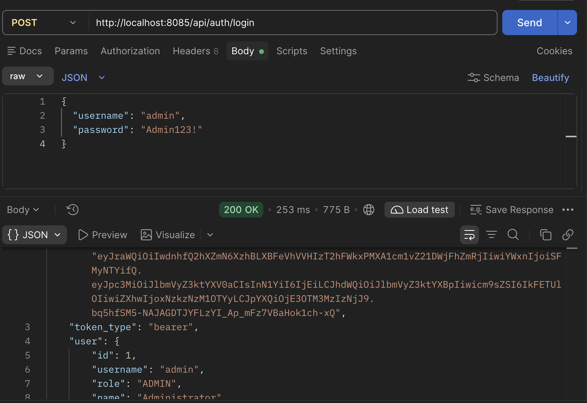
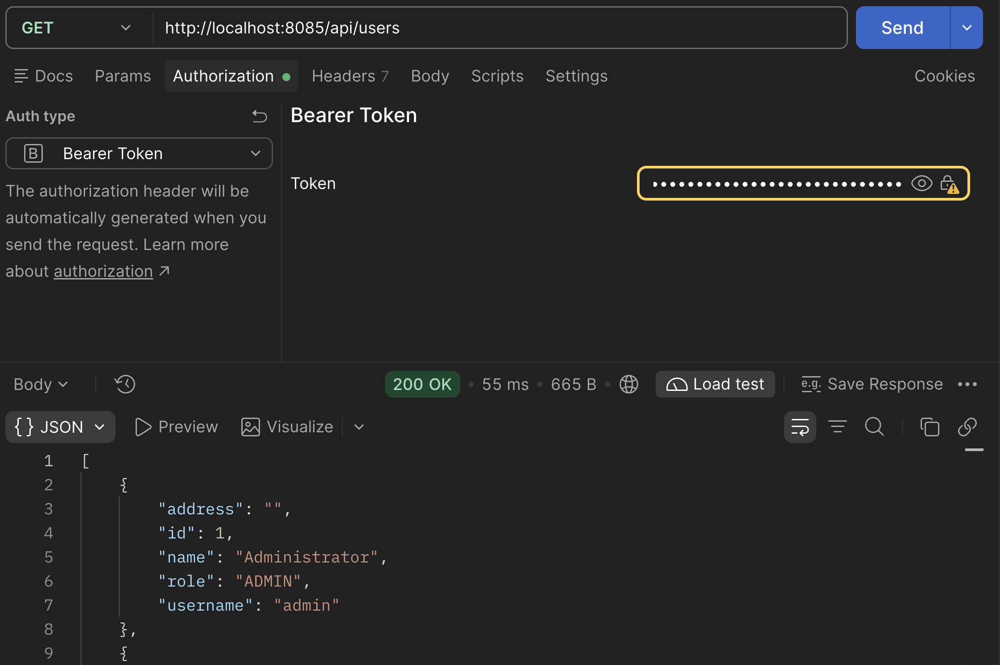
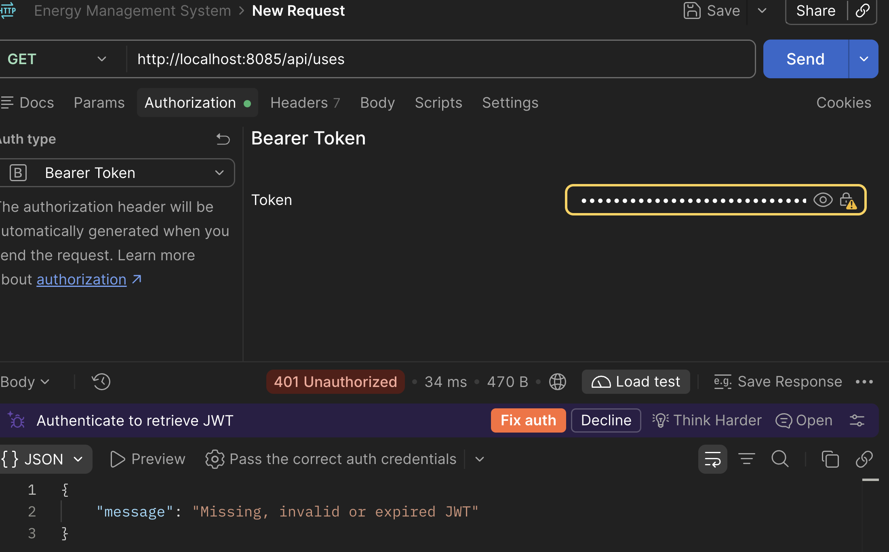

# Energy Management System

Proiect pentru cursul Distributed Systems, Assignment 1. Administratorul gestionează utilizatorii, dispozitivele și asocierile dintre ele. Clientul se autentifică și vede doar dispozitivele asociate contului său.

## Pornire

Ai nevoie de Docker Desktop și Docker Compose. Din rădăcina proiectului:

```bash
cp .env.example .env
```

În `.env`, setează valori proprii pentru `JWT_SECRET` și `INTERNAL_KEY` (diferite, aleatoare, de cel puțin 32 de caractere) și setează parola administratorului prin `ADMIN_PASSWORD`. Apoi pornește aplicația:

```bash
docker compose up --build -d
docker compose ps
```

Deschide [http://localhost:8085](http://localhost:8085). Portul public poate fi schimbat cu `APP_PORT` în `.env`. Doar Nginx publică un port pe host; serviciile Java și bazele de date comunică în rețeaua Docker.

Oprire:

```bash
docker compose down
```

Volumele bazelor de date rămân păstrate după oprire. `docker compose down -v` le șterge.

## Roluri și funcționalități

### Administrator

- autentificare;
- listare, creare, editare și ștergere utilizatori;
- listare, creare, editare și ștergere dispozitive;
- asociere și dezasociere dispozitive;
- la ștergerea unui utilizator, dispozitivele rămân în sistem și devin neasociate.

### Client

- creare cont și autentificare;
- vizualizare doar a dispozitivelor asociate contului;
- actualizare nume și adresă din profil.

Permisiunile sunt verificate în gateway, nu doar ascunse în interfață. Înregistrarea publică creează întotdeauna cont CLIENT.

## Postman

Folosește `http://localhost:8085` ca adresă de bază pentru toate cererile, ca traficul să treacă prin Nginx și gateway.

### Pregătirea colecției

1. Pornește proiectul conform secțiunii [Pornire](#pornire).
2. În Postman, creează colecția `Energy Management System`.
3. Adaugă Collection Variables: `baseUrl` = `http://localhost:8085`, `token`, `adminId`, `clientId`, `client2Id` și `deviceId` (lasă ultimele variabile goale inițial).
4. La Authorization pentru colecție selectează **Bearer Token** și setează valoarea la `{{token}}`.
5. Pentru register/login selectează **No Auth**. Pentru cererile cu body folosește **Body → raw → JSON**.

### Login admin și securitate

Creează `Admin - Login`: `POST {{baseUrl}}/api/auth/login`, No Auth, body:

```json
{
  "username": "admin",
  "password": "PAROLA_ADMIN_DIN_ENV"
}
```



Înlocuiește parola cu `ADMIN_PASSWORD` din `.env`. Răspunsul este `200 OK`. În Tests poți salva tokenul și ID-ul:

```javascript
const data = pm.response.json();
pm.collectionVariables.set("token", data.access_token);
pm.collectionVariables.set("adminId", data.user.id);
pm.test("Login reușit", () => pm.response.to.have.status(200));
```

Cu tokenul admin, `GET {{baseUrl}}/api/users` → `200 OK`. Șterge temporar `token` și repetă → `401 Unauthorized`. Încearcă o valoare inventată sau adaugă un caracter la finalul tokenului valid → `401`. Reautentifică-te ca admin după aceste verificări.





### Înregistrare și profil client

Înregistrează un client cu `POST {{baseUrl}}/api/auth/register`, No Auth:

```json
{
  "username": "client.demo",
  "password": "ClientDemo123!",
  "role": "ADMIN",
  "name": "Client Demo",
  "address": "Strada Exemplu 1"
}
```


Așteaptă `201 Created`; rolul din răspuns trebuie să fie `CLIENT` chiar dacă ai trimis `ADMIN`. Repetă pentru `client2.demo`, parola `Client2Demo123!`. Notează ID-urile ca `clientId` și `client2Id`. Username duplicat → `409 Conflict`; parolă prea scurtă → `400 Bad Request`.

Autentifică-te cu `POST {{baseUrl}}/api/auth/login`, No Auth, folosind primul client și copiază `access_token` în `token`. Apoi:

- `GET {{baseUrl}}/api/auth/me` → `200`, profilul propriu.
- `PUT {{baseUrl}}/api/auth/me` → `200`, cu body:

```json
{
  "name": "Client Demo Actualizat",
  "address": "Strada Noua 10"
}
```

- Repetă GET și verifică valorile salvate.
- Încearcă să incluzi `role`, `username`, `password` sau `id` la PUT → `400`.
- `GET {{baseUrl}}/api/users` cu token client → `403 Forbidden`.

### CRUD utilizatori

Autentifică-te din nou ca admin și actualizează `token`.

| Request | Rezultat așteptat |
|---|---|
| `GET {{baseUrl}}/api/users` | `200`, listă utilizatori |
| `GET {{baseUrl}}/api/users/{{clientId}}` | `200`, profil |
| `GET {{baseUrl}}/api/users/999999` | `404` |
| `POST {{baseUrl}}/api/users` | `201`, utilizator creat |
| Creare cu username duplicat | `409` |
| `PUT {{baseUrl}}/api/users/{{clientId}}` | `200`, profil actualizat |
| `DELETE {{baseUrl}}/api/users/{{clientId}}` | `204` |

Body pentru POST:

```json
{
  "username": "client.admincreated",
  "password": "AdminCreated123!",
  "role": "CLIENT",
  "name": "Creat de admin",
  "address": "Adresa 3"
}
```


Body pentru PUT:

```json
{
  "username": "client.demo",
  "role": "CLIENT",
  "name": "Nume Editat",
  "address": "Adresa Editata"
}
```

Parola omisă la PUT trebuie păstrată; verifică login-ul clientului cu parola existentă. Adminul nu își poate șterge sau retrograda propriul cont: DELETE pe `/api/users/{{adminId}}` sau PUT cu rolul `CLIENT` → `409 Conflict`.

### CRUD dispozitive

Cu token admin:

1. `GET {{baseUrl}}/api/devices` → `200`.
2. `POST {{baseUrl}}/api/devices` → `201`; salvează ID-ul ca `deviceId`:

```json
{
  "name": "Contor Demo",
  "maxConsumption": 4.5,
  "address": "Strada Exemplu 1",
  "userId": {{clientId}}
}
```

3. `GET {{baseUrl}}/api/devices/{{deviceId}}` → `200`.
4. `GET {{baseUrl}}/api/devices/by-user/{{clientId}}` → dispozitivul apare.
5. `PUT {{baseUrl}}/api/devices/{{deviceId}}` → `200`, cu body complet:

```json
{
  "name": "Contor Demo Actualizat",
  "maxConsumption": 8.25,
  "address": "Adresa Actualizata",
  "userId": {{clientId}}
}
```

6. POST cu `maxConsumption` egal cu `0` sau negativ → `400`.
7. Asociere la ID de utilizator inexistent → `404`.

### Asociere și izolare între clienți

Cu token admin, asociază dispozitivul clientului 2: `PUT {{baseUrl}}/api/devices/{{deviceId}}/assignment/{{client2Id}}` → `200`.

Autentifică-te ca `client.demo` și pune tokenul lui în `token`:

- `GET {{baseUrl}}/api/devices` → listă goală;
- `GET {{baseUrl}}/api/devices/{{deviceId}}` → `403`;
- `GET {{baseUrl}}/api/devices/by-user/{{client2Id}}` → `403`;
- POST, PUT sau DELETE pe dispozitive → `403`.

Autentifică-te ca `client2.demo`:

- `GET {{baseUrl}}/api/devices` → dispozitivul apare;
- `GET {{baseUrl}}/api/devices/{{deviceId}}` → `200`;
- accesarea dispozitivului clientului 1 → `403`.

### Dezasociere și ștergere

Autentifică-te din nou ca admin:

1. `DELETE {{baseUrl}}/api/devices/{{deviceId}}/assignment` → `200`; dispozitivul rămâne, fără asociere.
2. `GET {{baseUrl}}/api/devices/{{deviceId}}` → `userId` este `null`.
3. Asociază-l din nou cu `PUT /api/devices/{{deviceId}}/assignment/{{clientId}}`.
4. `DELETE {{baseUrl}}/api/users/{{clientId}}` → `204`.
5. Citește dispozitivul → există în continuare, dar `userId` este `null`.
6. `DELETE {{baseUrl}}/api/devices/{{deviceId}}` → `204`; repetă GET → `404`.

Ștergerea utilizatorului elimină profilul și credentialele și dezasociază dispozitivele. Dispozitivele rămân până la ștergerea lor explicită.

## API și Swagger

Toate cererile aplicației trec prin `http://localhost:8085/api`.

| Metodă și cale | Rol | Scop |
|---|---|---|
| `POST /auth/register` | Public | Creează un cont CLIENT |
| `POST /auth/login` | Public | Autentificare și emitere JWT |
| `GET /auth/me`, `PUT /auth/me` | Autentificat | Citește sau actualizează profilul propriu |
| `GET /users`, `POST /users` | Admin | Listează sau creează utilizatori |
| `GET`, `PUT`, `DELETE /users/{id}` | Admin | Citește, editează sau șterge un utilizator |
| `GET`, `POST /devices` | Admin / Client | Listează dispozitivele; adminul poate crea |
| `GET`, `PUT`, `DELETE /devices/{id}` | Admin / Client | Adminul gestionează dispozitivul; clientul îl poate citi dacă îi este asociat |
| `GET /devices/by-user/{userId}` | Admin / Client | Listează dispozitivele asociate unui utilizator |
| `PUT /devices/{id}/assignment/{userId}` | Admin | Asociază dispozitivul |
| `DELETE /devices/{id}/assignment` | Admin | Elimină asocierea, fără ștergerea dispozitivului |

Swagger UI:

- [User Service](http://localhost:8085/user-service/swagger-ui.html)
- [Device Service](http://localhost:8085/device-service/swagger-ui.html)
- [Authentication Service](http://localhost:8085/auth-service/swagger-ui.html)

Login și register nu necesită token. Celelalte rute protejate răspund cu `401` fără un token valid și cu `403` când rolul nu permite operația.

## Date demo

Pentru a adăuga date demo într-o instalare deja pornită:

```bash
node scripts/seed-demo.mjs
```

Scriptul folosește datele administratorului din `.env` și adaugă doar înregistrările care lipsesc.

## Arhitectură

- `frontend/` - interfață HTML, CSS și JavaScript;
- `nginx.conf` - servește frontend-ul și transmite `/api/` către gateway;
- `gateway/` - validează JWT-ul, verifică rolurile și rutează cererile;
- `auth-service/` - login, register, credentiale Argon2 și emitere JWT;
- `user-service/` - profiluri utilizator;
- `device-service/` - dispozitive și asocieri;
- PostgreSQL - baze separate `credential_db`, `user_db` și `device_db`.

Descrierea soluției: [docs/solution.md](docs/solution.md). Diagrama: [Deployment](docs/deployment.svg) · [Sursa PlantUML](docs/deployment.puml).

## Verificare

Cu aplicația pornită și Node.js 18+ instalat:

```bash
node scripts/smoke.mjs
```

Smoke-test-ul verifică login/register, JWT, roluri, izolarea dispozitivelor, CRUD, asocieri și Swagger; datele temporare sunt șterse la final.

Testele Java se rulează din fiecare director de serviciu (`gateway/`, `auth-service/`, `user-service/`, `device-service/`):

```bash
./mvnw test
```

## Baze de date și predare

Dump-urile PostgreSQL sunt în `docs/database/`. Pentru export cu containerele pornite:

```bash
sh scripts/dump.sh
```

