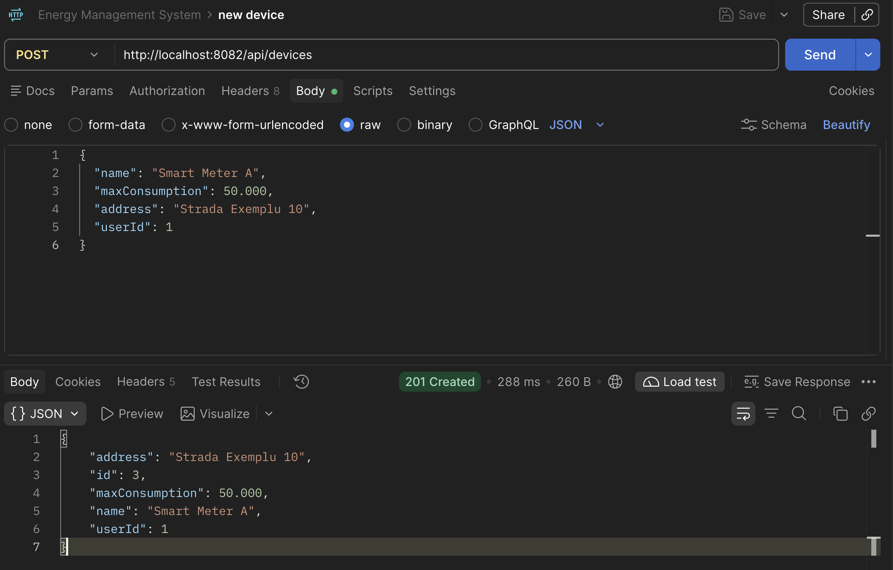
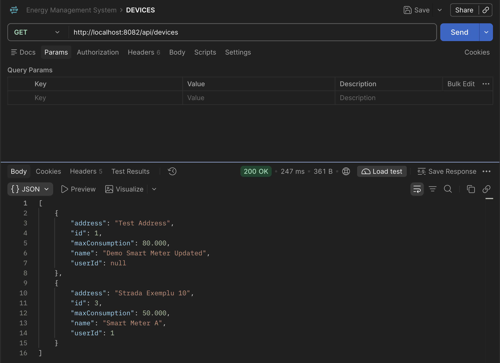
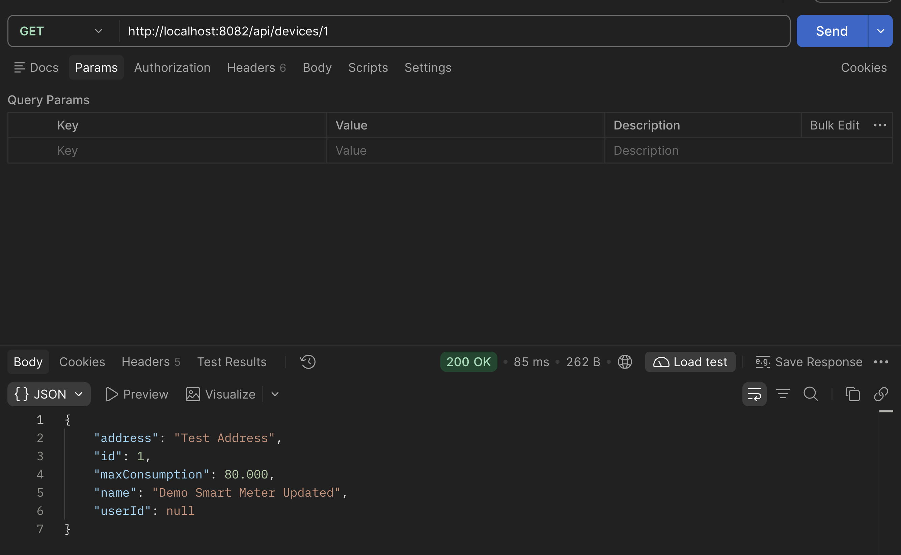
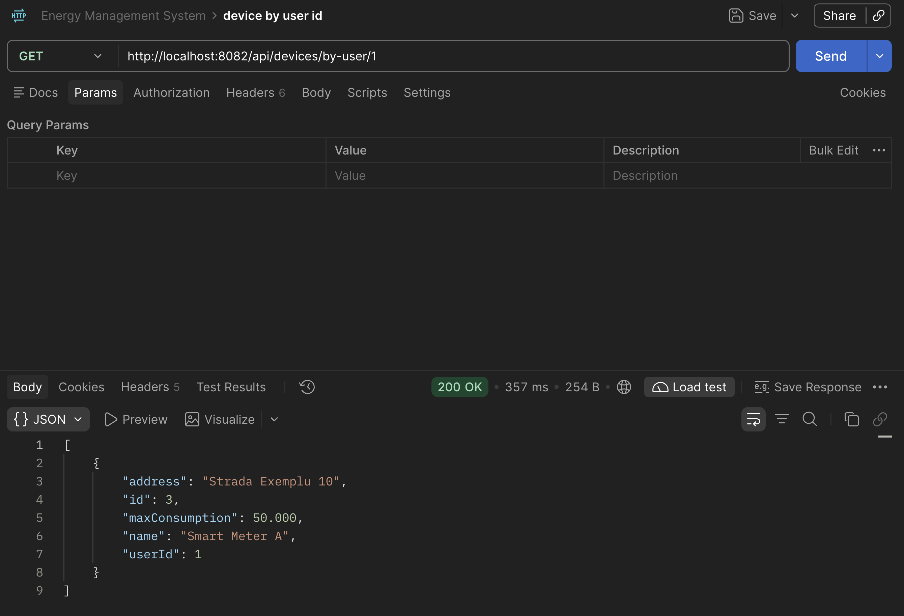
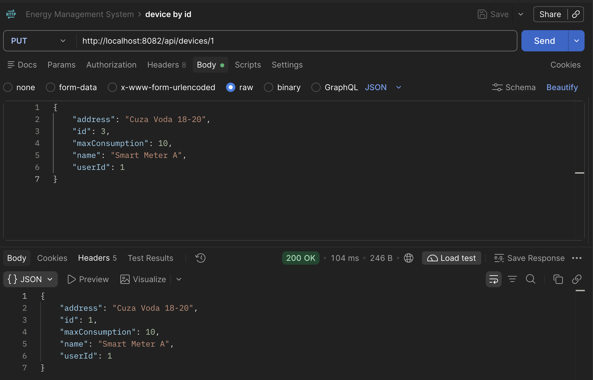
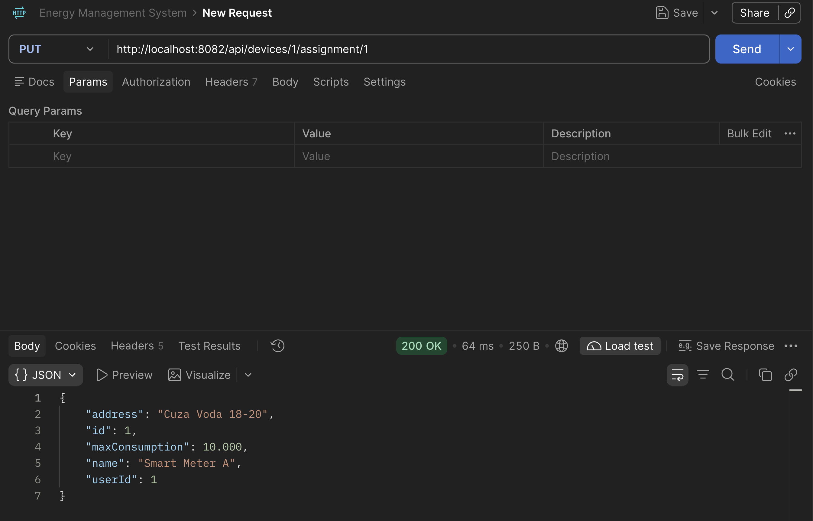
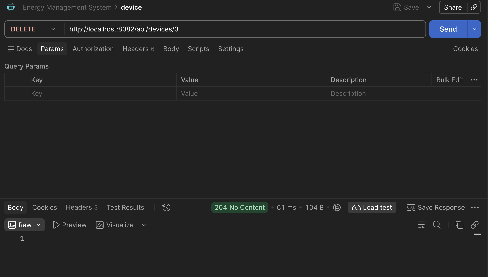

# Device Service

Device Service gestionează dispozitivele de măsurare a consumului energetic. Implementează operațiile CRUD și poate asocia fiecare dispozitiv cu un utilizator prin `userId`.

## Modelul dispozitivului

| Câmp | Tip | Descriere |
| --- | --- | --- |
| `id` | `Long` | ID generat automat |
| `name` | `String` | Numele dispozitivului; obligatoriu |
| `maxConsumption` | `BigDecimal` | Consumul maxim; trebuie să fie pozitiv |
| `address` | `String` | Adresa sau locația dispozitivului; opțional |
| `userId` | `Long` | ID-ul utilizatorului asociat; opțional |

`userId` este păstrat ca referință, fără cheie străină între bazele de date ale User Service și Device Service. Device Service nu verifică dacă utilizatorul există; această verificare și regulile de acces sunt responsabilitatea integrării dintre servicii/API Gateway.

## Pornire cu Docker Compose

Ai nevoie de Docker Desktop pornit. Din directorul `device-service`, rulează:

```bash
docker compose up --build
```

Compose pornește PostgreSQL și Device Service. PostgreSQL trebuie să fie healthy înainte de pornirea aplicației. Ca să poată rula simultan cu User Service, API-ul este publicat pe `http://localhost:8082` (portul intern al containerului este `8081`), iar baza de date pe `localhost:5434` (port intern `5432`).

Swagger UI: [http://localhost:8082/swagger-ui.html](http://localhost:8082/swagger-ui.html)  
OpenAPI JSON: [http://localhost:8082/api-docs](http://localhost:8082/api-docs)

Oprește containerele cu `Ctrl+C`, apoi rulează:

```bash
docker compose down
```

Datele PostgreSQL se păstrează în volumul Docker `device-service_device-db-data`; `docker compose down` nu șterge acest volum.

## Pornire locală

Pentru pornire locală ai nevoie de Java 21 și PostgreSQL. Creează baza `device_db`, apoi din directorul `device-service` rulează:

```bash
./mvnw spring-boot:run
```

Aplicația pornește implicit la `http://localhost:8081`. URL-ul, username-ul și parola bazei de date pot fi suprascrise prin `SPRING_DATASOURCE_URL`, `SPRING_DATASOURCE_USERNAME` și `SPRING_DATASOURCE_PASSWORD`. În Docker Compose, hostname-ul bazei este `postgres`.

## Endpoint-uri REST

URL-ul de bază pentru pornirea locală este `http://localhost:8081/api/devices`; pentru Docker Compose folosește `http://localhost:8082/api/devices`.

| Metodă | Endpoint | Descriere | Răspunsuri uzuale |
| --- | --- | --- | --- |
| `GET` | `/api/devices` | Listează toate dispozitivele | `200 OK` |
| `GET` | `/api/devices/{id}` | Caută un dispozitiv după ID | `200 OK`, `404 Not Found` |
| `GET` | `/api/devices/by-user/{userId}` | Listează dispozitivele asociate utilizatorului | `200 OK`, `400 Bad Request` |
| `POST` | `/api/devices` | Creează un dispozitiv | `201 Created`, `400 Bad Request` |
| `PUT` | `/api/devices/{id}` | Actualizează datele și asocierea | `200 OK`, `400 Bad Request`, `404 Not Found` |
| `PUT` | `/api/devices/{id}/assignment/{userId}` | Asociază dispozitivul cu utilizatorul | `200 OK`, `400 Bad Request`, `404 Not Found` |
| `DELETE` | `/api/devices/{id}/assignment` | Elimină asocierea, păstrând dispozitivul | `200 OK`, `404 Not Found` |
| `DELETE` | `/api/devices/{id}` | Șterge dispozitivul | `204 No Content`, `404 Not Found` |

Un nume gol sau un `maxConsumption` lipsă ori mai mic sau egal cu zero produce `400 Bad Request`. Un ID de dispozitiv inexistent produce `404 Not Found`.

## Exemple Postman

În Postman folosește `Body` → `raw` → `JSON` pentru cererile `POST` și `PUT`.

### Creare — `POST /api/devices`

```json
{
  "name": "Smart Meter A",
  "maxConsumption": 50.000,
  "address": "Strada Exemplu 10",
  "userId": 1
}
```

`userId` poate fi omis pentru a crea un dispozitiv neasociat. Răspunsul `201 Created` include ID-ul generat:

```json
{
  "id": 1,
  "name": "Smart Meter A",
  "maxConsumption": 50.000,
  "address": "Strada Exemplu 10",
  "userId": 1
}
```

### Listare și căutare

- `GET /api/devices` — toate dispozitivele.
- `GET /api/devices/1` — dispozitivul cu ID-ul `1`.
- `GET /api/devices/by-user/1` — dispozitivele asociate utilizatorului cu ID-ul `1`.

### Actualizare — `PUT /api/devices/1`

Trimite reprezentarea completă a dispozitivului. Pentru a elimina asocierea în acest endpoint, setează `userId` la `null`.

```json
{
  "name": "Smart Meter A - etaj 1",
  "maxConsumption": 60.500,
  "address": "Strada Exemplu 10",
  "userId": 1
}
```

### Asociere / dez-asociere

- `PUT /api/devices/1/assignment/1` — asociază dispozitivul `1` cu utilizatorul `1`.
- `DELETE /api/devices/1/assignment` — elimină asocierea, fără să șteargă dispozitivul.

### Ștergere — `DELETE /api/devices/1`

Răspunsul `204 No Content` confirmă ștergerea.

## Capturi Postman

Capturile Postman pentru operațiile principale și asocierea dispozitivelor sunt incluse mai jos.

### Creare dispozitiv



### Listarea dispozitivelor



### Căutare după ID



### Filtrare după ID-ul utilizatorului



### Actualizare dispozitiv



### Asociere dispozitiv cu utilizator



### Ștergere dispozitiv



## Build

Din directorul `device-service`, compilează aplicația cu:

```bash
./mvnw clean package -DskipTests
```
