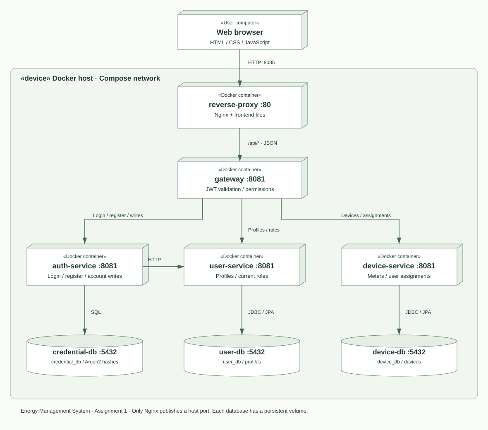

# Energy Management System - Assignment 1

Sistemul permite unui administrator să gestioneze utilizatori și dispozitive de măsurare a energiei. Clienții se autentifică și văd doar dispozitivele asociate contului lor.

## Deployment

Sursa editabilă a diagramei este în [deployment.puml](deployment.puml). Fiecare serviciu rulează într-un container separat. Nginx servește frontend-ul și transmite cererile `/api/` către gateway. Singurul port publicat de configurația integrată este portul Nginx, implicit 8085.

Toate cele patru servicii backend folosesc Java 21 și Spring Boot. User Service, Device Service și Authentication Service folosesc JPA. Authentication Service emite JWT-uri, iar gateway-ul le validează cu Spring Security. Interfața este scrisă în HTML, CSS și JavaScript, fără pas de compilare. Fiecare dintre cele trei baze de date PostgreSQL are propriul volum persistent.

## Date

User Database stochează ID, username, rol, nume și adresă. Credential Database stochează ID-ul utilizatorului, username și hash-ul Argon2 al parolei. Device Database stochează ID, nume, consum orar maxim, adresă și ID-ul utilizatorului asociat. Nu există foreign key între baze de date diferite; gateway-ul verifică existența utilizatorului înainte de asociere.

Parolele nu sunt returnate de API și nu sunt salvate în profilul utilizatorului. La creare, frontend-ul trimite parola către gateway, iar serviciul de autentificare creează profilul și credentialele.

## Autentificare și autorizare

1. Clientul trimite username și parolă la `POST /api/auth/login`.
2. Authentication Service verifică hash-ul din Credential Database și citește profilul din User Service.
3. Serviciul emite un JWT HS256, valabil o oră, cu subiectul, rolul, emitentul și audiența.
4. Browserul păstrează tokenul în sessionStorage și îl trimite în headerul `Authorization: Bearer ...`.
5. Gateway-ul verifică semnătura, expirarea, emitentul și audiența. Citește și rolul curent din User Service, astfel încât schimbarea rolului să fie aplicată imediat.
6. Administratorul are acces CRUD. Clientul poate citi propriile dispozitive și modifica propriul nume și propria adresă prin `/api/auth/me`, fără schimbarea username-ului, rolului sau parolei. Înregistrarea publică produce întotdeauna un cont CLIENT.

Logout șterge tokenul din browser. Tokenul nu are o listă de revocare; expiră după o oră. Conturile șterse nu mai au acces, deoarece gateway-ul verifică profilul la fiecare cerere. Serviciile interne și bazele de date nu publică porturi către host. Endpoint-urile interne ale Authentication Service necesită și o cheie internă.

## Operații importante

Administratorul poate crea și modifica profiluri, roluri și parole. O parolă omisă la editare rămâne neschimbată. Username-ul este unic. Administratorul nu își poate șterge sau retrograda propriul cont din sesiunea curentă.

Asocierea se poate modifica din formularul dispozitivului sau prin endpoint-urile dedicate. Valoarea `null` în `userId` elimină asocierea. Ștergerea unui utilizator dezleagă dispozitivele și șterge profilul și credentialele; dispozitivele rămân disponibile pentru reasociere.

Crearea contului compensează eșecul salvării credentialelor prin ștergerea profilului nou. Operațiile între servicii nu folosesc o tranzacție distribuită: o întrerupere exact între actualizarea profilului și actualizarea credentialelor poate necesita reconciliere manuală. Pentru acest laborator, serviciile sunt rulate pe aceeași rețea Docker și erorile de dependență sunt raportate către client.

## Validare

`scripts/smoke.mjs` verifică prin Nginx autentificarea, înregistrarea, autorizarea, izolarea între clienți, CRUD, validarea consumului, actualizarea credentialelor, asocierea și documentația OpenAPI. Testele Java folosesc H2 pentru CRUD și credentiale și verifică emiterea JWT și respingerea tokenurilor expirate, cu semnătură, emitent sau audiență invalide. Datele testelor HTTP sunt șterse la final.

## Predare

Enunțul cere cod sursă, dump-urile bazelor de date, diagrama UML și instrucțiunile de build/rulare. Repository-ul trebuie să fie pe GitLab, cu numele `DS2026_Group_LastName_FirstName_Assignment_Number`, și partajat cu `utcn_dsrl`. Aceste setări GitLab se verifică separat înainte de predare.
