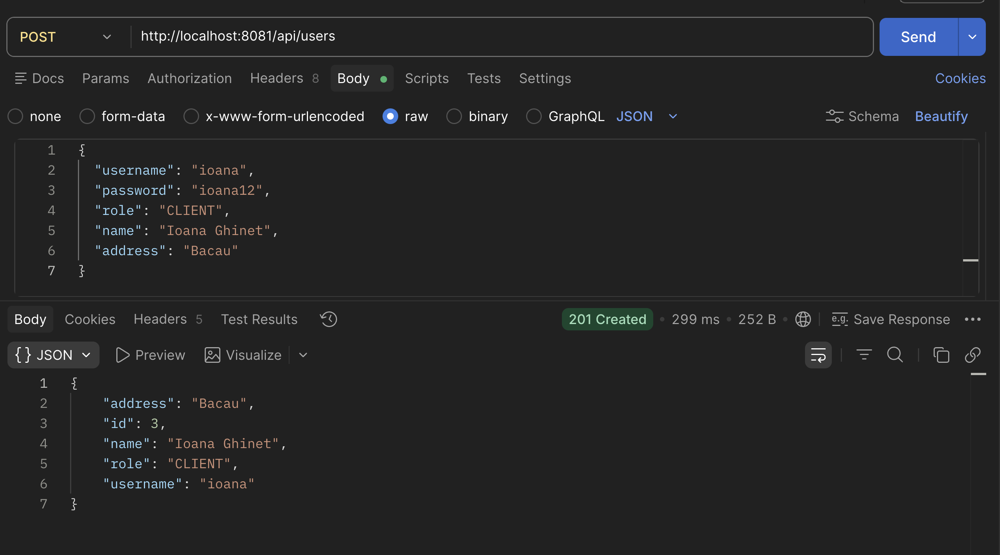
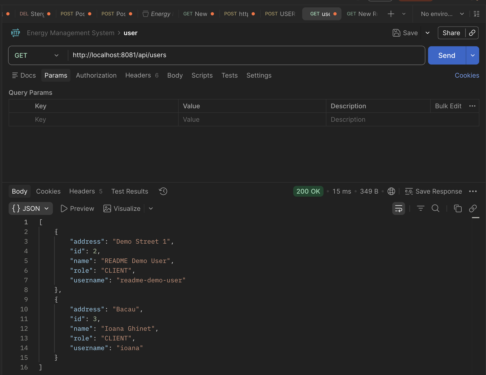
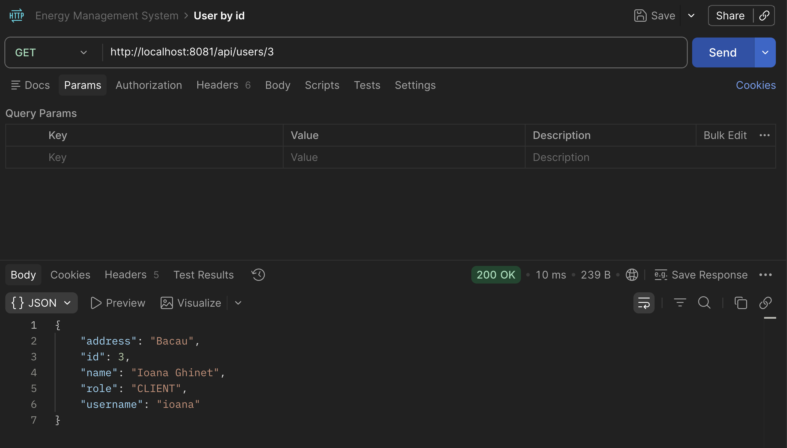
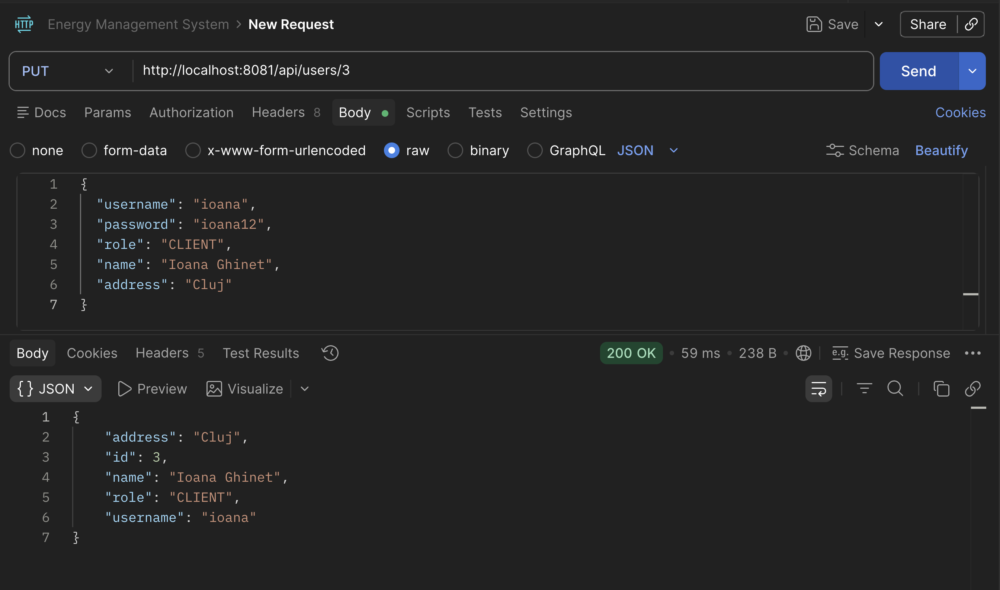
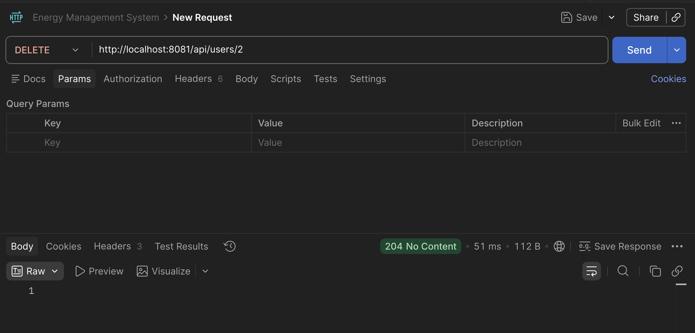
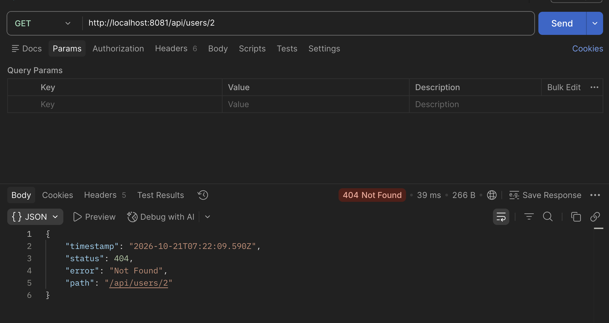

# User Service

User Service gestionează utilizatorii aplicației Energy Management System printr-un API REST. Serviciul permite operații CRUD, verifică unicitatea username-ului și returnează date prin DTO-uri. Parola nu este inclusă în răspunsurile API.

## Funcționalități

- Listarea tuturor utilizatorilor și căutarea după ID.
- Crearea, actualizarea și ștergerea utilizatorilor.
- Detectarea username-urilor duplicate.
- Roluri disponibile: `CLIENT` și `ADMIN`.
- Câmpuri pentru utilizator: `id`, `username`, `password`, `role`, `name`, `address`.
- Baza de date este PostgreSQL; conexiunea poate fi configurată prin variabile de mediu.

## Pornire cu Docker Compose

Din directorul `user-service`, pornește PostgreSQL și User Service împreună:

```bash
docker compose up --build
```

Compose așteaptă ca PostgreSQL să fie pregătit înainte să pornească User Service. API-ul este disponibil la `http://localhost:8081/api/users`, iar Swagger UI la `http://localhost:8081/swagger-ui.html`. Portul `8081` de pe Mac este mapat la portul `8081` din container. PostgreSQL este mapat la `localhost:5433`; în rețeaua Docker, aplicația se conectează la `postgres:5432`.

Oprește containerele cu `Ctrl+C`, apoi rulează:

```bash
docker compose down
```

Datele bazei sunt păstrate în volumul `user-db-data` la oprire.

## Pornire locală

Ai nevoie de Java și de o instanță PostgreSQL disponibilă. Configurația implicită se conectează la baza `user_db` pe `localhost:5432`, cu utilizatorul și parola `postgres`.

1. Creează baza de date `user_db` în PostgreSQL.
2. Deschide terminalul în directorul `user-service`.
3. Pornește aplicația:

   ```bash
   ./mvnw spring-boot:run
   ```

   Pe Windows, folosește `mvnw.cmd spring-boot:run`.

Serviciul pornește implicit la `http://localhost:8081`.

### Configurarea conexiunii la baza de date

Valorile implicite pot fi suprascrise cu variabilele de mediu:

| Variabilă | Valoare implicită |
| --- | --- |
| `SPRING_DATASOURCE_URL` | `jdbc:postgresql://localhost:5432/user_db` |
| `SPRING_DATASOURCE_USERNAME` | `postgres` |
| `SPRING_DATASOURCE_PASSWORD` | `postgres` |

Pentru Docker Compose, setează URL-ul cu numele serviciului PostgreSQL ca hostname, de exemplu:

```text
SPRING_DATASOURCE_URL=jdbc:postgresql://postgres:5432/user_db
SPRING_DATASOURCE_USERNAME=postgres
SPRING_DATASOURCE_PASSWORD=postgres
```

În acest exemplu, `postgres` trebuie să fie numele serviciului/containerului bazei de date accesibil din rețeaua Docker.

## Endpoint-uri REST

URL-ul de bază este `http://localhost:8081/api/users`.

| Metodă | Endpoint | Descriere | Răspunsuri uzuale |
| --- | --- | --- | --- |
| `GET` | `/api/users` | Listează utilizatorii | `200 OK` |
| `GET` | `/api/users/{id}` | Caută un utilizator după ID | `200 OK`, `404 Not Found` |
| `POST` | `/api/users` | Creează un utilizator | `201 Created`, `400 Bad Request`, `409 Conflict` |
| `PUT` | `/api/users/{id}` | Actualizează un utilizator | `200 OK`, `400 Bad Request`, `404 Not Found`, `409 Conflict` |
| `DELETE` | `/api/users/{id}` | Șterge un utilizator | `204 No Content`, `404 Not Found` |

La creare, `username`, `password` și `role` sunt obligatorii. La actualizare sunt obligatorii `username` și `role`; `password` poate fi omisă sau lăsată goală pentru a păstra parola curentă. `name` și `address` sunt opționale.

Un username deja folosit produce `409 Conflict`. Un ID inexistent produce `404 Not Found`. Câmpurile obligatorii lipsă produc `400 Bad Request`.

## Exemple pentru Postman

În Postman, folosește `http://localhost:8081/api/users` ca URL de bază și setează `Body` → `raw` → `JSON` pentru cererile `POST` și `PUT`.

### Creare — `POST /api/users`

```json
{
  "username": "ana.popescu",
  "password": "parola-exemplu",
  "role": "CLIENT",
  "name": "Ana Popescu",
  "address": "Bucuresti"
}
```

Răspunsul este `201 Created`, cu datele utilizatorului și ID-ul generat. Câmpul `password` nu apare în răspuns:

```json
{
  "id": 1,
  "username": "ana.popescu",
  "role": "CLIENT",
  "name": "Ana Popescu",
  "address": "Bucuresti"
}
```

### Listare — `GET /api/users`

Returnează lista utilizatorilor. Răspunsul fiecărui utilizator nu conține parola.

### Căutare după ID — `GET /api/users/1`

Înlocuiește `1` cu ID-ul întors la creare. Pentru un ID care nu există, API-ul răspunde cu `404 Not Found`.

### Actualizare — `PUT /api/users/1`

```json
{
  "username": "ana.popescu",
  "role": "ADMIN",
  "name": "Ana Popescu",
  "address": "Cluj-Napoca"
}
```

Parola existentă este păstrată când proprietatea `password` lipsește sau este goală. Pentru schimbarea parolei, trimite o valoare nouă în acel câmp.

### Ștergere — `DELETE /api/users/1`

Răspunsul `204 No Content` confirmă ștergerea. Verifică apoi cu `GET /api/users/1`, care ar trebui să întoarcă `404 Not Found`.

## Capturi Postman

Capturile de mai jos arată răspunsurile obținute la testarea endpoint-urilor cu Postman. Fișierele sunt în `src/main/resources/img/`.

### Creare utilizator



### Listarea utilizatorilor — `GET /api/users`



### Căutarea unui utilizator după ID — `GET /api/users/3`



### Actualizarea unui utilizator — `PUT /api/users/3`



### Ștergerea unui utilizator — `DELETE /api/users/2`



### Verificarea după ștergere — `GET /api/users/2`

Captura confirmă că utilizatorul nu mai există după ștergere (`404 Not Found`).



## Swagger / OpenAPI

Cu serviciul pornit, documentația interactivă este disponibilă la:

- Swagger UI: [http://localhost:8081/swagger-ui.html](http://localhost:8081/swagger-ui.html)
- OpenAPI JSON: [http://localhost:8081/api-docs](http://localhost:8081/api-docs)

## Verificarea build-ului

Din directorul `user-service`, rulează:

```bash
./mvnw clean verify
```

## Notă despre parole

API-ul nu returnează parola, însă serviciul persită valoarea primită în cerere. Hash-uirea și verificarea parolelor trebuie integrate cu Auth Service înainte de folosirea într-un mediu real.
